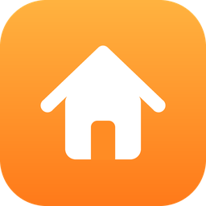

# Home Glass Dashboard

An iOS 26 "Liquid Glass" style dashboard for Home Assistant, generated automatically from your areas and devices. No YAML, no Mushroom, no card-mod.

## Features

- **Automatic layout** from your areas and devices: rooms, favorites, scenes, cameras, weather and energy, all reorderable.
- **iOS 26 Liquid Glass look**: translucent tiles with specular edges, light and dark schemes that follow your HA theme, and wallpaper-aware title colors.
- **Quick controls**: long-press a tile (or press the context-menu key) for brightness, color temperature and colors, cover position, fan speed, thermostat target and mode, or media volume and transport.
- **Media tiles** with album artwork and a play/pause button.
- **Home summary** under the title, e.g. "3 lights on · Front door unlocked · 22–25°C", with alerts first.
- **Dynamic wallpaper** that follows the sun (`sun.sun`), from night to dawn, day, golden hour and dusk.
- **Accessibility**: keyboard access to every tile, focus rings, and support for reduced motion, reduced transparency (also as a "Solid surfaces" setting) and increased contrast.
- 10 languages.

## Install (HACS)

1. HACS → ⋮ → Custom repositories → add `https://github.com/gilsonsouzah/hass-home-glass-dashboard` (category **Integration**).
2. Install **Home Glass Dashboard** and restart Home Assistant.
3. Settings → Devices & services → Add integration → **Home Glass Dashboard**.
4. Settings → Dashboards → Add dashboard → pick **Home Glass**.

The integration serves and registers the frontend bundle itself; there is no Lovelace resource to add.

### Coming from Apple Home Dashboard

Dashboards using `custom:apple-home-strategy` keep working, with their saved customizations. Remove the old `apple-home-dashboard.js` resource and plugin from HACS after installing this one.

## Credits

Based on [nitaybz/apple-home-dashboard](https://github.com/nitaybz/apple-home-dashboard) (MIT).
